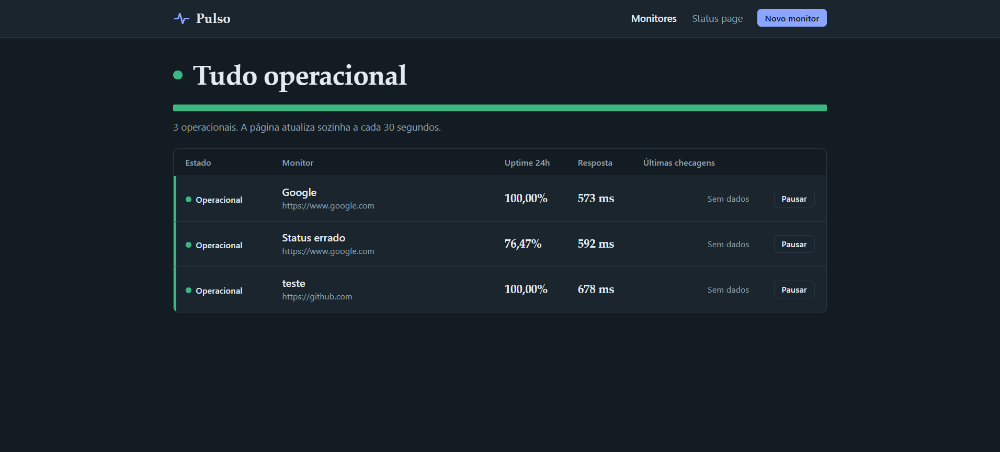
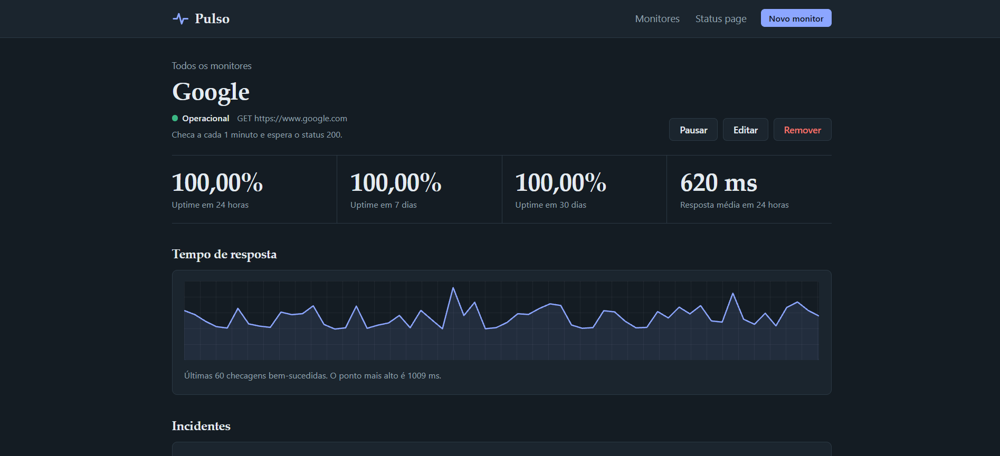
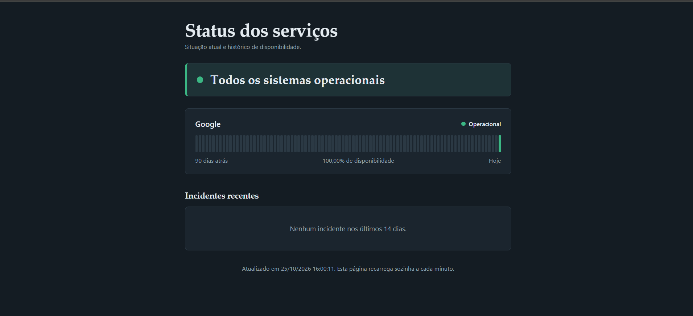
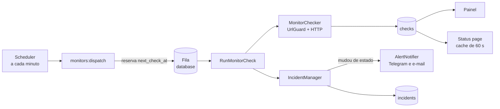

<div align="center">

# Pulso

**Monitor de uptime com status page pública, incidentes e alertas por Telegram e e-mail.**

Feito em Laravel, com SQLite e fila no próprio banco: nenhum serviço externo para subir.


[Visão geral](#visão-geral) ·
[Funcionalidades](#funcionalidades) ·
[Como funciona](#como-funciona) ·
[Segurança](#segurança) ·
[Instalação](#instalação) ·
[Configuração](#configuração) ·
[Testes](#testes) ·
[Produção](#produção)

</div>

---

## Visão geral

O Pulso verifica sites e APIs em intervalos que você define, registra cada resposta, decide quando um serviço realmente caiu e avisa por Telegram e e-mail, só quando o estado muda. Uma status page pública mostra a situação atual e os últimos 90 dias de disponibilidade, sem expor URLs nem detalhes técnicos.

Nasceu como projeto de estudo de Laravel (Scheduler, filas, Eloquent, testes) e foi desenvolvido para ser usado de verdade.

## Capturas de tela

| Painel | Detalhe de um monitor | Status page pública |
|:--:|:--:|:--:|
|  |  |  |

## Funcionalidades

**Monitoramento**
- Checagens por GET ou HEAD, com status HTTP esperado, timeout e intervalo configuráveis por monitor (de 1 minuto a 24 horas).
- Verificação opcional de palavra-chave no corpo da resposta, para pegar sites que respondem 200 com uma página de erro.
- Pausar e retomar monitores sem perder o histórico.

**Incidentes e alertas**
- Um monitor só é declarado fora do ar depois de **3 falhas seguidas** (configurável), o que evita alarme falso por uma oscilação de rede.
- Cada queda vira um incidente com início, fim, duração e motivo.
- Alertas por **Telegram** e **e-mail** apenas na transição (caiu, voltou), nunca a cada falha.

**Painel**
- Estado geral em uma frase, barra de saúde e, em cada monitor, o traço das últimas checagens (a altura de cada barra é o tempo de resposta).
- Uptime de 24 horas, 7 e 30 dias, tempo médio de resposta, gráfico, incidentes e histórico de checagens.
- Tema claro e escuro automáticos, layout responsivo, sem JavaScript.

**Status page pública**
- Você escolhe, monitor a monitor, o que aparece.
- Barras de 90 dias, uptime do período e incidentes recentes.
- Cache de 60 segundos e limite de requisições por IP.

## Como funciona



### A máquina de estados

| Situação | O que acontece |
|---|---|
| Falha abaixo do limite (padrão: 3 seguidas) | Só incrementa o contador de falhas. Nenhum alerta. |
| Falha que atinge o limite | O monitor vira `down`, um incidente é aberto e o alerta de queda é enviado. |
| Falha com o monitor já `down` | Nada de novo: sem incidente duplicado, sem alerta repetido. |
| Sucesso com o monitor `down` | O monitor vira `up`, o incidente é fechado e o alerta de recuperação é enviado. |
| Sucesso em qualquer outro caso | Zera o contador e mantém `up`. |

### Decisões de projeto

- **Reserva antes de despachar.** O comando avança o `next_check_at` antes de colocar o Job na fila. Se a fila atrasar, o mesmo monitor não é despachado duas vezes.
- **Jobs velhos são descartados.** Um Job que esperou mais de 2 minutos na fila (worker parado, por exemplo) é ignorado. Sem isso, um acúmulo processado de uma vez contaria várias "falhas seguidas" em poucos segundos e geraria um alarme falso.
- **Falha de rede é resultado, não exceção.** Timeout, DNS que não resolve e URL bloqueada viram uma checagem com `is_successful = false`, porque "o site está fora" é justamente a informação que se quer guardar.
- **Banco em UTC, datas exibidas no seu fuso.** Mudar o fuso da aplicação deslocaria os dados antigos. Apenas a exibição é convertida (padrão `America/Bahia`).
- **Poucas dependências.** Nenhum pacote além do Laravel, nenhum build de front-end, nenhum Redis.

## Segurança

Um monitor de uptime faz requisições para endereços digitados por alguém, o que o torna um alvo clássico de **SSRF** (usar o servidor para alcançar a rede interna). As defesas:

| Risco | Proteção |
|---|---|
| Acessar a rede interna (`127.0.0.1`, `10.x`, `192.168.x`, `169.254.169.254`) | O `UrlGuard` resolve o host e bloqueia faixas privadas, reservadas, CGNAT (`100.64.0.0/10`) e IPv4 embutido em IPv6. A validação roda no cadastro e a cada checagem. |
| **DNS rebinding** (o DNS responde um IP público na validação e um interno na conexão) | Os IPs validados são fixados na conexão com `CURLOPT_RESOLVE`. O cURL não consulta o DNS de novo. O certificado e o SNI continuam usando o nome do site. |
| Redirecionamento para um destino interno | Os redirecionamentos são seguidos manualmente, no máximo 3, e cada destino passa pela mesma validação. O tempo total respeita o timeout do monitor. |
| Esquemas perigosos (`file://`, `gopher://`) | Só `http` e `https`. |
| Painel exposto por esquecimento | Acesso por HTTP Basic. Sem credenciais configuradas, o painel só abre em ambiente `local` e responde 403 em qualquer outro. |
| Vazamento pela status page | Só aparecem nome, estado e horários. URLs, mensagens de erro e causas de incidentes nunca são exibidas. |
| Token do bot nos logs | O token do Telegram é mascarado antes de qualquer mensagem de erro ir para o log. |

> Em desenvolvimento, `PULSO_ALLOW_PRIVATE_HOSTS=true` permite monitorar `localhost`. **Nunca ative isso em produção.**

## Instalação

**Requisitos:** PHP compatível com a versão do Laravel (testado com PHP 8.5), extensões `curl` e `pdo_sqlite`, e Composer.

```bash
git clone https://github.com/ArthurCoode/Pulso
cd pulso

composer install
cp .env.example .env            # PowerShell: Copy-Item .env.example .env
php artisan key:generate

touch database/database.sqlite  # PowerShell: New-Item database\database.sqlite -ItemType File
php artisan migrate
```

Para o Pulso trabalhar de verdade, três processos precisam estar rodando (um terminal para cada):

```bash
php artisan serve               # a interface web
php artisan schedule:work       # dispara as checagens a cada minuto
php artisan queue:work          # executa as checagens
```

Abra **http://127.0.0.1:8000**, cadastre um monitor e, em até 1 minuto, a primeira checagem aparece. Se a porta 8000 já estiver ocupada por outro projeto, use `php artisan serve --port=8081`.

## Configuração

Tudo é configurado por variáveis no `.env`. Os valores abaixo são os padrões.

| Variável | Padrão | Para que serve |
|---|---|---|
| `PULSO_FAILURE_THRESHOLD` | `3` | Falhas seguidas necessárias para declarar um monitor fora do ar. |
| `PULSO_MAX_JOB_AGE` | `120` | Idade máxima (em segundos) de um Job na fila. Acima disso ele é descartado. |
| `PULSO_RETENTION_DAYS` | `120` | Dias de checagens guardados. O mínimo efetivo é 90, porque a status page usa 90 dias. |
| `PULSO_TIMEZONE` | `America/Bahia` | Fuso das datas exibidas. O banco continua em UTC. |
| `PULSO_ALLOW_PRIVATE_HOSTS` | `false` | Libera monitorar endereços internos. Só para desenvolvimento. |
| `PULSO_USER_AGENT` | `PulsoMonitor/1.0` | User-Agent enviado nas checagens. |
| `PULSO_ADMIN_USER` / `PULSO_ADMIN_PASSWORD` | vazio | Credenciais do painel (HTTP Basic). Obrigatórias fora do ambiente local. |
| `PULSO_STATUS_TITLE` / `PULSO_STATUS_DESCRIPTION` | texto padrão | Título e descrição da status page. |
| `PULSO_ALERT_EMAIL` | vazio | Destinatário dos alertas por e-mail. |
| `PULSO_TELEGRAM_BOT_TOKEN` / `PULSO_TELEGRAM_CHAT_ID` | vazio | Bot e conversa dos alertas no Telegram. |

Cada canal de alerta só é usado se estiver configurado. Por padrão o Laravel usa `MAIL_MAILER=log`, então os e-mails caem em `storage/logs/laravel.log` em vez de serem enviados, o que é ideal para testar. Para enviar de verdade, configure `MAIL_MAILER=smtp` e as variáveis `MAIL_*`.

### Configurando o Telegram

1. Fale com o **@BotFather**, envie `/newbot` e guarde o token.
2. Abra uma conversa com o seu bot e envie qualquer mensagem.
3. Acesse `https://api.telegram.org/bot<SEU_TOKEN>/getUpdates` (sem os sinais `<` e `>`) e copie o número de `"chat": {"id": ...}`.
4. Coloque o token e o id no `.env` e reinicie o `queue:work`.

Nunca versione o token. Se ele vazar, revogue com `/revoke` no BotFather.

## Uso

| Comando | O que faz |
|---|---|
| `php artisan monitors:dispatch` | Despacha as checagens dos monitores que estão no horário (o Scheduler chama a cada minuto). |
| `php artisan monitors:prune` | Apaga checagens além da retenção, em lotes (o Scheduler chama todo dia às 03:30). Aceita `--days=N`, nunca abaixo de 90. |
| `php artisan schedule:work` | Roda o Scheduler em desenvolvimento. |
| `php artisan queue:work` | Processa a fila. |

Páginas: o painel fica em `/monitors` e a status page pública em `/status`.

## Testes

```bash
php artisan test
```

A suíte roda em SQLite em memória e **não faz nenhuma requisição de rede**: tudo é simulado com `Http::fake()`, e requisições não simuladas viram erro. Uma trava no `TestCase` aborta a execução se o banco não for em memória, para que ninguém apague o banco de desenvolvimento por engano.

| Área | O que é verificado |
|---|---|
| `UrlGuard` | Bloqueio de faixas privadas, reservadas, CGNAT e IPv4 mapeado em IPv6, esquemas inválidos e URLs malformadas. |
| `MonitorChecker` | Sucesso, status errado, palavra-chave, falha de rede, redirecionamento para rede interna, limite de redirecionamentos. |
| `IncidentManager` | Limite de falhas, alerta uma única vez, recuperação, ausência de duplicatas. |
| `RunMonitorCheck` | Execução normal, descarte de Jobs velhos, monitor pausado ou apagado. |
| `monitors:prune` | Apaga só o que passou da retenção e respeita o mínimo de 90 dias. |
| Painel e status page | Autenticação, cadastro com validação SSRF, o checkbox "público", e a garantia de que a status page não vaza URL, erro nem causa. |
| Telas | Renderização do painel, do detalhe e dos formulários com dados reais. |

## Estrutura do projeto

```
app/
├── Console/Commands/      DispatchDueChecks, PruneOldChecks
├── Enums/                 MonitorStatus
├── Exceptions/            UnsafeUrlException
├── Http/
│   ├── Controllers/       MonitorController, StatusPageController
│   ├── Middleware/        AdminAccess
│   └── Requests/          MonitorRequest
├── Jobs/                  RunMonitorCheck
├── Models/                Monitor, Check, Incident
├── Services/              MonitorChecker, UrlGuard, IncidentManager,
│                          AlertNotifier, UptimeCalculator, StatusPageData
└── Support/               Format
config/pulso.php           Toda a configuração do Pulso
public/css/pulso.css       Folha de estilos única (painel e status page)
resources/views/           Layout, painel e status page
tests/                     Testes unitários e de funcionalidade
```

## Produção

Um resumo do que muda fora do seu computador:

1. **Variáveis:** `APP_ENV=production`, `APP_DEBUG=false`, `PULSO_ALLOW_PRIVATE_HOSTS=false` e `PULSO_ADMIN_USER` / `PULSO_ADMIN_PASSWORD` definidos.
2. **HTTPS é obrigatório.** O HTTP Basic envia a senha em cada requisição, então sem HTTPS ela trafega legível.
3. **Scheduler:** uma única linha no cron do servidor.

   ```cron
   * * * * * cd /caminho/do/pulso && php artisan schedule:run >> /dev/null 2>&1
   ```

4. **Fila:** um processo `queue:work` sempre ativo, reiniciado se cair (Supervisor, por exemplo), de preferência com mais de um worker para que checagens lentas não atrasem as outras.

   ```ini
   [program:pulso-worker]
   command=php /caminho/do/pulso/artisan queue:work --sleep=3 --max-time=3600
   autostart=true
   autorestart=true
   numprocs=2
   process_name=%(program_name)s_%(process_num)02d
   ```

5. **Depois de cada atualização:** `php artisan migrate --force`, `php artisan config:cache` e reinicie os workers (`php artisan queue:restart`), porque eles só carregam o código ao iniciar.

## Roadmap

- [ ] Multiusuário, com login e monitores por conta
- [ ] Canais de alerta por monitor (webhook, Slack, Discord)
- [ ] Checagens TCP e ping, além de HTTP
- [ ] Verificação de validade do certificado SSL, com aviso antes de expirar
- [ ] Janelas de manutenção programadas
- [ ] Gráfico de latência de 7 e 30 dias
- [ ] Verificação a partir de mais de uma região

## O que este projeto exercita

Scheduler e filas do Laravel, Eloquent (relações, escopos, casts e enums), Form Requests com regras personalizadas, camada de serviços, cache e rate limiting, defesa contra SSRF e DNS rebinding, e testes com `Http::fake()` e Mockery.

## Autor

Feito por **Arthur**.

- GitHub: [@ArthurCoode](https://github.com/ArthurCoode)
- Portfólio: [marquescode.com](https://marquescode.com)

## Licença

Distribuído sob a licença MIT. Veja o arquivo `LICENSE`.

---

<details>
<summary><strong>English summary</strong></summary>

**Pulso** is a self-hosted uptime monitor built with Laravel. It checks sites and APIs on a schedule, opens incidents only after consecutive failures (no flapping alerts), notifies via Telegram and email on state changes, and serves a public status page with 90-day availability bars that never exposes URLs or error details.

It uses SQLite and the database queue, so there is nothing to run besides PHP. Security was a design goal: SSRF protection with private/reserved/CGNAT range blocking, DNS-rebinding defense by pinning validated IPs with `CURLOPT_RESOLVE`, and manually validated redirects.

Quick start: `composer install`, copy `.env.example` to `.env`, `php artisan key:generate`, create `database/database.sqlite`, `php artisan migrate`, then run `php artisan serve`, `php artisan schedule:work` and `php artisan queue:work`. Run the tests with `php artisan test`.

</details>